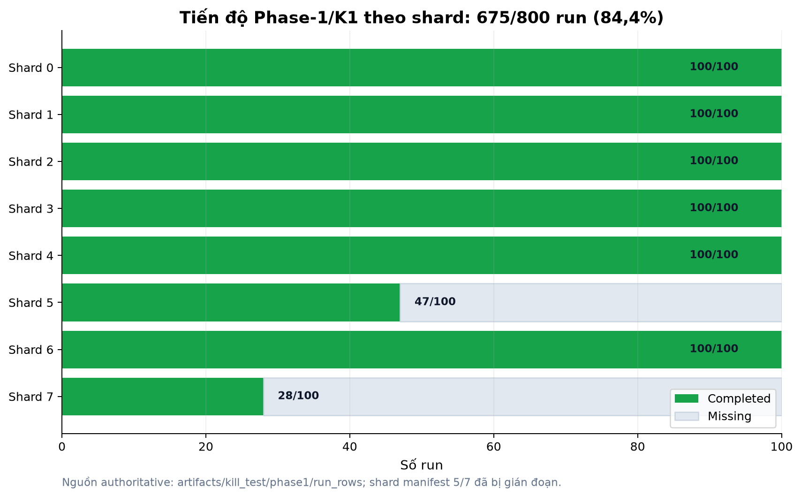
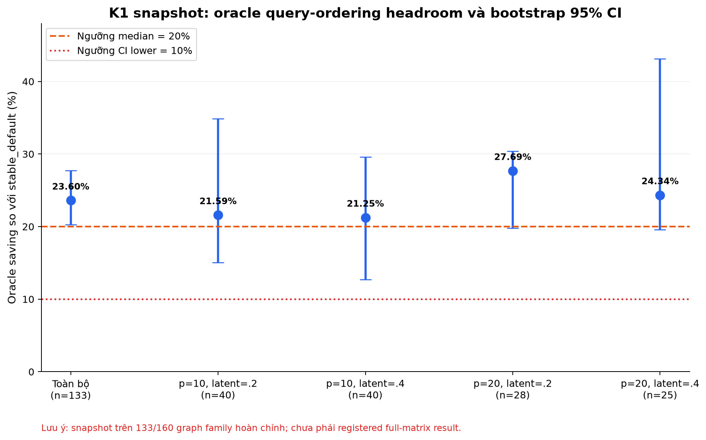

# BÁO CÁO NGHIÊN CỨU K0–K4

## Safety Prior cho khám phá nhân quả có biến ẩn

**Ngày cập nhật:** 20/10/2026  
**Kho mã nguồn:** `safety_prior`  
**Phạm vi báo cáo:** K0, K1, K2, K3 và K4 của kill test đã đăng ký trước  

---

## 0. Mục tiêu bài toán

`Tối ưu thứ tự tính toán của FCI để đạt kết quả hữu ích sớm hơn với ít chi phí hơn, trong khi vẫn bảo toàn tính đúng đắn nhân quả khi chạy đầy đủ.`  
~  
`Giúp thuật toán khám phá quan hệ nhân quả chạy nhanh và tiết kiệm hơn trên dữ liệu có biến ẩn, nhưng vẫn giữ kết quả đáng tin cậy.`

## 1. Tóm tắt điều hành

Chương trình K0–K4 kiểm tra tuần tự năm câu hỏi:

1. **K0 — Giữ nguyên các phép tính và quy tắc, nhưng đổi thứ tự phép tính nào được thực hiện trước; có giữ nguyên logic nhân quả khi chạy đủ không?**
2. **K1 — Có dư địa để tối ưu thứ tự truy vấn không? ~ Nếu chọn thứ tự truy vấn CI tốt hơn, ta có thể giảm thêm bao nhiêu phép kiểm định mà vẫn đạt cùng mức chất lượng?**
3. **K2 — Thông tin từ chuyên gia hoặc LLM, dù có sai sót, có giúp chọn truy vấn hữu ích chạy trước và giảm đủ nhiều phép tính hay không?**
4. **K3 — Lợi ích có còn trước baseline mạnh và khi lỗi của prior tương quan theo nút/mô-típ không?**
5. **K4 — Khi CI được ước lượng từ mẫu hữu hạn, lợi ích tính toán có đi kèm mức tổn hại endpoint chấp nhận được không?**

Trạng thái tại thời điểm báo cáo:

| Cổng | Trạng thái nghiên cứu | Diễn giải chính xác |
| --- | --- | --- |
| **K0** | **`PASS`** | 220/220 lượt chạy cho đầu ra chính tắc tương đương; không có lỗi cơ học |
| **K1** | **`PASS` theo quyết định dự án** | 133 họ đồ thị hoàn chỉnh cho tín hiệu dương; ma trận tái lập mới đạt 675/800 lượt nên cổng tự động chưa được đóng chính thức |
| **K2** | **`NOT_RUN`** | Chưa chạy prior B ở các mức AUC đã đăng ký |
| **K3** | **`NOT_RUN`** | Chưa chạy lỗi tương quan và chưa hoàn thiện đầy đủ baseline mạnh |
| **K4** | **`NOT_RUN` / bị chặn** | Chưa chạy mẫu hữu hạn; còn các vấn đề tham chiếu RFCI/PAG phải đóng trước tuyên bố chính thức |

Kết luận hiện tại chỉ là:

> K0 xác nhận lớp lập lịch không làm đổi kết quả khi chạy đủ trong testbed cơ học. K1 tiếp tục cho thấy tồn tại dư địa tính toán đáng kể từ việc xếp thứ tự truy vấn trong phạm vi FAS-stable/khung xương. Chưa có bằng chứng rằng prior thực tế, prior có lỗi tương quan hoặc dữ liệu hữu hạn mẫu sẽ giữ được lợi ích đó; các câu hỏi này lần lượt thuộc K2, K3 và K4.

---

## 2. Cơ chế thuật toán cần biết để hiểu K0–K4

### 2.1 FCI giải bài toán gì?

FCI (*Fast Causal Inference*) là thuật toán khám phá nhân quả dựa trên các phép kiểm định độc lập có điều kiện khi có thể tồn tại biến ẩn. Đầu vào là dữ liệu quan sát hoặc một bộ phán định CI chính xác; đầu ra hoàn chỉnh là PAG (*Partial Ancestral Graph*, đồ thị tổ tiên riêng phần).

Một truy vấn CI có dạng:

```text
CI(X, Y | S): X có độc lập với Y khi đã biết tập S hay không?
```

FCI hoạt động ở mức cao như sau:

```text
khởi tạo đồ thị đầy đủ
    ↓
FAS: kiểm định CI với tập điều kiện tăng dần để xóa cạnh
    ↓
lưu tập phân tách và định hướng các nút hội tụ
    ↓
Possible-D-SEP: tìm thêm tập phân tách ngoài lân cận trực tiếp
    ↓
áp dụng các luật định hướng đến khi không còn thay đổi
    ↓
PAG cuối
```

#### Tìm khung xương bằng FAS

FAS (*Fast Adjacency Search*) tăng dần kích thước tập điều kiện `l=0,1,2,...`:

```text
với mỗi độ sâu l:
    với mỗi cạnh X—Y còn tồn tại:
        sinh các tập S hợp lệ có |S|=l
        nếu CI(X,Y|S) cho kết quả độc lập:
            xóa X—Y
            lưu S làm tập phân tách
```

FAS-stable đóng băng tập lân cận tại đầu mỗi độ sâu, nhờ đó giảm phụ thuộc vào thứ tự xét cạnh. Tuy nhiên, số truy vấn CI vẫn có thể rất lớn và thứ tự chạy quyết định tốc độ đạt một khung xương trung gian tốt.

#### Possible-D-SEP và định hướng PAG

Khi có biến ẩn, tập phân tách cần thiết có thể chứa nút không còn là hàng xóm trực tiếp. Possible-D-SEP mở rộng vùng tìm kiếm dựa trên các đường có cấu trúc phù hợp. Sau khi tìm khung xương, FCI dùng tập phân tách và các luật định hướng để xác định đuôi, mũi tên hoặc vòng tròn ở đầu mút cạnh.

Một lượt chạy dừng vì hết ngân sách chỉ tạo **trạng thái khám phá dở dang**, không phải PAG cuối. Trạng thái này phải kèm lịch sử truy vấn, vùng chưa kiểm tra và ngân sách đã dùng.

### 2.2 Prior được phép tác động ở đâu?

Safety Prior chỉ được dùng trong lớp điều khiển:

- xếp thứ tự các truy vấn CI đang hợp lệ;
- phân bổ ngân sách giữa các truy vấn/vùng;
- ưu tiên truy vấn có chi phí hoặc lợi ích dự đoán tốt hơn.

Prior không được:

- tự trả lời một truy vấn CI;
- trực tiếp xóa, thêm hoặc định hướng cạnh;
- nhìn kết quả CI chưa được thực thi;
- thay đổi luật FCI;
- được dùng làm sự thật đánh giá.

Ngoại lệ duy nhất là `oracle_query`, được cố ý cho biết giá trị truy vấn để đo **cận trên lý tưởng**. Nó không phải một phương pháp có thể triển khai ngoài thực tế.

### 2.3 Mối quan hệ giữa năm cổng

```text
K0: đổi lịch có giữ nguyên đầu ra khi chạy đủ?
    │
    ├─ Không → NO-GO: lớp lập lịch làm sai logic nhân quả
    │
    └─ Có
       ↓
K1: oracle có tạo dư địa?
    │
    ├─ Không → NO-GO: không có cơ chế để prior khai thác
    │
    └─ Có
       ↓
K2: prior khả dụng có lấy lại được một phần dư địa?
    │
    ├─ Không → đổi giao diện prior hoặc NO-GO cho framing hiện tại
    │
    └─ Có
       ↓
K3: lợi ích có bền trước baseline mạnh và lỗi tương quan?
    │
    ├─ Không → hiệu ứng mong manh hoặc do baseline yếu
    │
    └─ Có
       ↓
K4: lợi ích còn an toàn dưới CI hữu hạn mẫu?
    │
    ├─ Không → NO-GO cho tuyên bố an toàn/đầu-cuối
    └─ Có → GO hoặc GO WITH CONDITIONS
```

---

## 3. Hợp đồng thực nghiệm chung

### 3.1 Sự thật mô phỏng và nguồn tham chiếu

Trong mô phỏng, hệ thống sinh một DAG đầy đủ gồm biến quan sát và biến ẩn. Oracle CI kiểm tra d-separation trên DAG đầy đủ nhưng tập điều kiện chỉ chứa biến quan sát. PAG từ FCI oracle chạy đủ ngân sách được dùng làm nguồn tham chiếu vận hành.

PAG tham chiếu này chưa phải bộ chuyển đổi DAG-có-biến-ẩn sang PAG được xác minh độc lập. Vì vậy, các chỉ số tương thích MAG/PAG và quan hệ tổ tiên chưa được dùng để quyết định gate cho tới khi vấn đề OI-02 được đóng.

### 3.2 Ngân sách

Mỗi đồ thị được chuẩn hóa theo chi phí của lượt `stable_default` chạy đủ. Các mốc ngân sách là 10%, 25%, 50% và 100%. Chi phí có trọng số của một truy vấn `q=(X,Y,S)` là:

```text
cost(q) = (|S| + 2)^3
```

Nếu một truy vấn làm vượt trần ngân sách, truy vấn đó không được chạy. Hệ thống phải trả trạng thái dở dang trung thực thay vì gắn nhãn PAG hoàn chỉnh.

### 3.3 Đơn vị thống kê

- K1–K3 ghép cặp kết quả theo cùng hạt giống đồ thị.
- K4 ghép cặp theo cùng hạt giống đồ thị và hạt giống dữ liệu.
- Đơn vị bootstrap là đồ thị hoặc cặp đồ thị/dữ liệu, không phải cạnh và không phải từng lượt scheduler.
- Khoảng tin cậy 95% dùng 10.000 lần tái lấy mẫu với seed đã khóa.
- Lượt smoke không được dùng làm bằng chứng đạt gate.

### 3.4 Trạng thái gate hợp lệ

Chỉ có bốn trạng thái máy đọc được:

- `PASS`: đủ toàn bộ ma trận và đạt ngưỡng;
- `FAIL`: đủ bằng chứng nhưng không đạt ngưỡng;
- `BLOCKED`: đã có dữ liệu nhưng thiếu điều kiện bắt buộc;
- `NOT_RUN`: chưa chạy pha tương ứng.

Không dùng trạng thái “partial pass”. Một ảnh chụp chưa đủ ma trận có thể hỗ trợ quyết định dự án, nhưng không thay thế bản ghi gate chính thức.

---

## 4. K0 — Tính hợp lệ cơ học của lớp lập lịch

### 4.1 Câu hỏi và giả thuyết

K0 hỏi:

> Nếu chỉ thay thứ tự thực thi các truy vấn hợp lệ, một lượt chạy đủ ngân sách có còn cho cùng đầu ra chính tắc với thuật toán cơ sở không?

Đây là điều kiện tiên quyết cho toàn bộ nghiên cứu. Nếu scheduler làm thay đổi tập truy vấn hợp lệ, bỏ qua phụ thuộc hoặc tự tạo quyết định đồ thị, mọi mức tiết kiệm đo ở K1–K4 đều không còn ý nghĩa.

### 4.2 Testbed K0

| Thành phần | Thiết kế |
| --- | --- |
| Số đồ thị oracle nhỏ | 20 |
| Lịch cơ sở trên mỗi đồ thị | 1 lịch ổn định |
| Lịch đối chứng trên mỗi đồ thị | 10 lịch ngẫu nhiên hợp lệ |
| Tổng lượt chạy | `20 × (1 + 10) = 220` |
| Ngân sách | Đầy đủ |
| CI | Oracle trên DAG đầy đủ |
| Mục tiêu so sánh | Đầu ra đồ thị chính tắc và dấu vết nguồn gốc |

Lịch ngẫu nhiên chỉ được chọn trong tập truy vấn đang hợp lệ; nó không được vượt qua hàng rào phụ thuộc giữa tìm khung xương, Possible-D-SEP và định hướng.

### 4.3 Các bất biến bắt buộc

K0 chỉ đạt khi tất cả điều kiện sau cùng đúng:

1. mọi lịch nhìn thấy cùng vũ trụ ứng viên theo hợp đồng;
2. không truy vấn nào được chạy trước khi đủ điều kiện;
3. các phụ thuộc giữa các pha được tôn trọng;
4. prior/scheduler không trực tiếp tạo bằng chứng xóa hoặc định hướng cạnh;
5. chạy lại cùng seed tạo cùng dấu vết chính tắc;
6. đầu ra đầy đủ giống thuật toán tham chiếu sau khi chuẩn hóa thứ tự nút và biểu diễn endpoint.

Bất kỳ một sai khác không giải thích được nào về đầu ra đầy đủ đều bác bỏ tính hợp lệ cơ học của thiết kế scheduler.

### 4.4 Kết quả K0

| Chỉ báo | Kết quả |
| --- | ---: |
| Lượt hoàn thành | **220/220** |
| Tỷ lệ tương đương chính tắc | **1,0** |
| Lượt lỗi | **0** |
| Quyết định | **`PASS`** |

K0 xác nhận rằng trong ma trận cơ học đã chạy, việc thay lịch không làm đổi đầu ra khi đủ ngân sách. K0 không chứng minh scheduler hữu ích, không đo headroom và không đánh giá prior sai; những câu hỏi đó bắt đầu từ K1.

---

## 5. K1 — Dư địa của bộ lập lịch tiên tri

### 5.1 Câu hỏi và giả thuyết

K1 hỏi:

> Nếu biết trước truy vấn nào sẽ giúp tìm tập phân tách, việc chạy các truy vấn đó sớm hơn có giảm đáng kể lượng CI cần để đạt chất lượng khung xương mục tiêu không?

K1 không kiểm tra LLM. Nó kiểm tra điều kiện cần: nếu ngay cả lịch tiên tri cũng không giúp, mọi prior thực tế yếu hơn oracle khó có lý do để tiếp tục.

```text
                 ┌──────────────▶ X4
                 │
X5 ─────▶ X1 ────┼──▶ (L11 ẩn) ───▶ X3 ◀──── X8
 │               │                                │
 ├───────────────┘                                └──▶ X6
 │
 ├────▶ X7
 │
 └────▶ (L10 ẩn) ───▶ X2

X0           X9
(cô lập)     (cô lập)
```

### 5.2 Testbed K1

| Trục | Giá trị |
| --- | --- |
| Số biến quan sát | 10, 20 |
| Tỷ lệ biến ẩn | 0,2; 0,4 |
| Bậc trung bình | 2; 4 |
| Hạt giống mỗi ô | 20 |
| Tổng số đồ thị | `2 × 2 × 2 × 20 = 160` |
| CI | Oracle |
| Số bộ lập lịch/đồ thị | 5 |
| Tổng lượt logic | `160 × 5 = 800` |

Năm bộ lập lịch:

| Bộ lập lịch | Vai trò |
| --- | --- |
| `stable_default` | Baseline tất định, không dùng prior |
| `random_valid` | Chọn ngẫu nhiên trong ứng viên đang hợp lệ |
| `cost_only` | Ưu tiên truy vấn ước lượng rẻ hơn |
| `graph_only` | Dùng trạng thái đồ thị nhưng không dùng sự thật oracle |
| `oracle_query` | Biết trước truy vấn hữu ích; cận trên chẩn đoán |

*note: `graph_only` => Ưu tiên kiểm tra các cặp nằm ở vùng đang có nhiều cạnh, vì nếu tìm được tập phân tách tại đó thì có thể loại sớm một cạnh trong vùng phức tạp; đồng thời phạt nhẹ các truy vấn đắt tiền.

Phạm vi can thiệp hiện tại là `FAS_STABLE_SKELETON_ONLY`: scheduler điều khiển truy vấn trong FAS-stable/khung xương. Possible-D-SEP được ghi log nhưng chưa được scheduler sắp lại. Vì vậy K1 không phải bằng chứng về headroom của toàn bộ FCI.

### 5.3 Chỉ số và ngưỡng K1

`tests_to_95` là số truy vấn CI đầu tiên cần để khung xương bằng chứng tạm thời đạt ít nhất 95% chất lượng F1 của baseline chạy đủ.

Với đồ thị `g` và baseline `b`:

```text
saving_g = [tests_to_95(b,g) - tests_to_95(oracle,g)]
           / tests_to_95(b,g)
```

K1 đạt khi đồng thời:

1. mức tiết kiệm trung vị so với `stable_default` ít nhất 20%;
2. cận dưới khoảng tin cậy bootstrap 95% lớn hơn 10%;
3. đạt tiêu chuẩn nhóm ở ít nhất 3/4 nhóm theo số biến quan sát và tỷ lệ biến ẩn.

### 5.4 Tiến độ dữ liệu

| Phân mảnh | Dự kiến | Đã hoàn thành | Còn thiếu |
| ---: | ---: | ---: | ---: |
| 0 | 100 | 100 | 0 |
| 1 | 100 | 100 | 0 |
| 2 | 100 | 100 | 0 |
| 3 | 100 | 100 | 0 |
| 4 | 100 | 100 | 0 |
| 5 | 100 | 47 | 53 |
| 6 | 100 | 100 | 0 |
| 7 | 100 | 28 | 72 |
| **Tổng** | **800** | **675** | **125** |



*Hình 1 — Tiến độ K1 theo các dòng kết quả `run_rows`. Toàn bộ phần thiếu nằm ở phân mảnh 5 và 7.*

Tất cả 675 dòng hiện có mang trạng thái kết thúc `completed`; không phát hiện dòng trùng, mã ngoài dự kiến hoặc JSON hỏng. Có 133 đồ thị hoàn thành đủ năm bộ lập lịch và ba đồ thị mới hoàn thành một phần.

### 5.5 Kết quả tạm thời trên 133 đồ thị hoàn chỉnh

| So sánh oracle với | Mức tiết kiệm trung vị | Khoảng tin cậy bootstrap 95% |
| --- | ---: | ---: |
| `stable_default` | **23,60%** | **[20,24%, 27,74%]** |
| `random_valid` | 22,23% | [17,96%, 24,95%] |
| `cost_only` | 24,04% | [20,08%, 27,23%] |
| `graph_only` | 28,55% | [23,64%, 33,11%] |

Kết quả phân nhóm so với `stable_default`:

| Nhóm | Số đồ thị đầy đủ | Tiết kiệm trung vị | Khoảng tin cậy 95% | Đạt ngưỡng nhóm tạm thời |
| --- | ---: | ---: | ---: | --- |
| `p=10`, tỷ lệ ẩn `0,2` | 40 | 21,59% | [15,03%, 34,86%] | Có |
| `p=10`, tỷ lệ ẩn `0,4` | 40 | 21,25% | [12,68%, 29,58%] | Có |
| `p=20`, tỷ lệ ẩn `0,2` | 28 | 27,69% | [19,78%, 30,39%] | Có |
| `p=20`, tỷ lệ ẩn `0,4` | 25 | 24,34% | [19,59%, 43,13%] | Có |



*Hình 2 — Mức tiết kiệm trung vị và khoảng tin cậy bootstrap 95% trên 133 đồ thị hoàn chỉnh. Đây là ảnh chụp tạm thời, không thay thế phân tích đủ 160 đồ thị.*

### 5.6 Kết luận K1 và giới hạn

**Quyết định dự án:** `PASS`.

Lý do: ước lượng điểm vượt 20%, cận dưới vượt 10% và cả bốn nhóm hiện tại đều đạt tiêu chuẩn tạm thời.

Tuy nhiên:

- ma trận chính thức còn thiếu 125/800 lượt;
- tệp `reports/kill_test/gate_status.json` chưa được tái sinh từ `run_rows` hiện tại và vẫn ghi `NOT_RUN`;
- không được sửa tệp gate bằng tay; phải hoàn tất ma trận rồi chạy lại bộ phân tích;
- K1 không chứng minh prior B hoặc LLM đạt được mức tiết kiệm;
- K1 không chứng minh giảm thời gian thực bằng đúng giảm số CI;
- K1 không bao phủ việc lập lịch toàn bộ Possible-D-SEP hoặc định hướng PAG.

---

## 6. K2 — Prior khả dụng có khai thác được dư địa không?

### 6.1 Câu hỏi

K2 chuyển từ oracle không khả dụng sang một giao diện tri thức có thể được cung cấp bởi chuyên gia, ontology hoặc LLM:

> Với chất lượng xếp hạng trung bình, prior về thành viên tập phân tách có lấy lại được một phần đáng kể lợi ích của oracle không?

### 6.2 Hai loại prior trong Pha 2

#### Prior A — oracle truy vấn bị nhiễu

Prior A chấm điểm trực tiếp từng truy vấn rồi thêm nhiễu. Nó chỉ dùng để chẩn đoán scheduler cần tín hiệu mạnh tới mức nào; nó không đại diện cho tri thức thực tế vì gần với việc đoán trực tiếp kết quả CI.

#### Prior B — thành viên tập phân tách

Với mỗi bộ ba `(X,Y,Z)`, Prior B dự đoán liệu `Z` có thuộc ít nhất một tập phân tách quan sát được tối thiểu của cặp `(X,Y)` hay không. Nó không được nhận nhãn “truy vấn này sẽ độc lập”.

Điểm của truy vấn có tập điều kiện `S` được tạo bằng quy tắc cố định:

```text
score(X,Y,S) = trung bình claim-score của các Z trong S - 0,05 × |S|
```

Tập rỗng nhận phần đóng góp prior bằng 0. Quy tắc không được huấn luyện lại trên đồ thị kiểm thử.

### 6.3 Ma trận chất lượng prior

| Mức prior | AUC mục tiêu |
| --- | ---: |
| Gần ngẫu nhiên | 0,55 |
| Trung bình — mức chính của K2 | 0,65 |
| Khá | 0,75 |
| Đối nghịch | 0,425; dung sai bao phủ khoảng 0,40–0,45 |

AUC được tính trong từng đồ thị và pha lập lịch trên các truy vấn đủ điều kiện, rồi lấy trung bình vĩ mô theo đồ thị. Ô không có đủ cả lớp dương và âm phải được báo cáo và loại khỏi AUC, không được tự điền. AUC thực tế phải nằm trong ±0,02 quanh mục tiêu.

### 6.4 Chỉ số K2

K2 dùng lại các đồ thị của K1 và so sánh ghép cặp trên cùng đồ thị. Hai đại lượng chính là:

```text
prior_saving   = mức tiết kiệm của Prior B so với baseline tốt nhất
oracle_saving  = mức tiết kiệm của oracle so với cùng baseline
recovery_ratio = prior_saving / oracle_saving
```

`recovery_ratio` trả lời Prior B lấy lại được bao nhiêu phần lợi ích lý tưởng của oracle.

### 6.5 Ngưỡng K2 đã đăng ký

Prior B tại AUC thực tế 0,65 phải đồng thời:

1. thu hồi ít nhất **30%** phần tiết kiệm của oracle;
2. giảm ít nhất **8%** trung vị số CI so với baseline không prior tốt nhất;
3. có cận dưới bootstrap 95% của mức cải thiện lớn hơn 0;
4. đạt ở ít nhất 3/4 nhóm chính.

### 6.6 Trạng thái K2

**`NOT_RUN`.** Cấu hình Pha 2 đã khóa tại `configs/kill_test/phase2.yaml`, nhưng chưa có ma trận kết quả K2. Không được suy K2 từ kết quả K1: oracle biết trực tiếp giá trị truy vấn, trong khi Prior B chỉ cung cấp tín hiệu thành viên tập phân tách có lỗi.

Nếu K2 thất bại, kết luận phù hợp là:

> Thứ tự truy vấn có dư địa về lý thuyết, nhưng giao diện prior hiện tại không chuyển được tri thức khả dụng thành lợi ích đủ lớn.

---

## 7. K3 — Độ bền trước baseline mạnh và lỗi tương quan

### 7.1 Vì sao K3 cần thiết?

Một prior có thể trông hữu ích vì hai lý do giả:

1. baseline so sánh quá yếu;
2. bộ sinh lỗi chỉ lật từng claim độc lập, trong khi chuyên gia hoặc LLM thường sai theo cụm.

K3 kiểm tra cả hai nguy cơ.

### 7.2 Ba kiểu lỗi

| Kiểu lỗi | Cơ chế |
| --- | --- |
| Độc lập | Từng claim bị nhiễu riêng lẻ |
| Tương quan theo nút | Một nhóm nút “mù” làm mọi claim liên quan cùng dễ sai |
| Tương quan theo mô-típ | Prior nhầm theo vùng chuỗi, ngã ba, nút hội tụ hoặc nhiễu ẩn |

Các chế độ phải có cùng AUC biên trong dung sai 0,02. Nếu AUC khác nhau, không thể kết luận suy giảm đến từ tương quan thay vì prior đơn giản là kém chính xác hơn.

### 7.3 Baseline cần so sánh

- `stable_default`/FCI-stable không prior;
- `random_valid`;
- `cost_only`;
- `graph_only`;
- RFCI-stable và phương pháp targeted/score-guided gần nhất khi có triển khai tái lập được.

FCI-stable hiện là baseline chính đã triển khai. RFCI-stable chưa có backend trong repo, nên mọi tuyên bố bao phủ RFCI vẫn bị chặn bởi OI-01.

### 7.4 Ngưỡng K3 đã đăng ký

K3 yêu cầu:

1. với lỗi theo nút hoặc mô-típ ở cùng AUC, lợi ích không được mất quá **50%** so với lỗi độc lập;
2. tại AUC 0,55, hệ thống không được thua baseline không prior quá **5%** một cách có hệ thống;
3. với prior đối nghịch, hệ thống được phép kém hơn nhưng sự suy giảm phải hiện rõ trên nhật ký/đường cong rủi ro;
4. prior không được trực tiếp tạo endpoint có vẻ chắc chắn;
5. lợi ích không được biến mất chỉ vì thay baseline yếu bằng baseline ổn định hoặc chỉ dùng dữ liệu/đồ thị.

### 7.5 Trạng thái K3

**`NOT_RUN`.** Chưa có dữ liệu cho ba kiểu lỗi đã hiệu chỉnh AUC và chưa đóng toàn bộ baseline mạnh. Vì vậy hiện chưa thể nói prior bền với lỗi tương quan hoặc hơn các đối chứng công bằng.

Nếu chỉ lỗi độc lập đạt nhưng lỗi theo nút/mô-típ mất phần lớn lợi ích, kết luận phải là **NO-GO hoặc đổi trọng tâm**, không được dùng kết quả lỗi độc lập để tuyên bố phương pháp bền vững.

---

## 8. K4 — An toàn và hữu ích dưới mẫu hữu hạn

### 8.1 Câu hỏi

K1–K3 chủ yếu tách cơ chế lập lịch và chất lượng prior. K4 đưa lỗi thống kê thực tế vào hệ thống:

> Khi CI được ước lượng bằng Fisher-Z trên dữ liệu hữu hạn, Prior B có còn giảm chi phí mà không làm tăng quá mức số endpoint xác định sai không?

### 8.2 Testbed Pha 3

| Trục | Giá trị |
| --- | --- |
| Số biến quan sát | 20 |
| Tỷ lệ biến ẩn | 0,3 |
| Bậc trung bình | 2,5 |
| Cơ chế dữ liệu | Tuyến tính Gaussian |
| Cỡ mẫu | 500, 2000 |
| Hạt giống đồ thị | 30 |
| Hạt giống dữ liệu/đồ thị | 3 |
| Tổng bộ dữ liệu | `2 × 30 × 3 = 180` |
| CI backend | Fisher-Z, `alpha=0,05` |

Mọi phương pháp phải chạy trên cùng cặp hạt giống đồ thị/dữ liệu, cùng CI, cùng `alpha` và cùng ngân sách.

### 8.3 Baseline bắt buộc

- FCI-stable và RFCI-stable không prior;
- random, cost-only và graph-only scheduler;
- oracle scheduler;
- Prior B với lỗi độc lập, theo nút và theo mô-típ;
- hard-prior như đối chứng âm;
- FCIT hoặc phương pháp targeted/score-guided gần nhất nếu có mã tái lập được.

Thiếu một baseline bắt buộc phải được báo cáo như rủi ro tài liệu chưa đóng, không được diễn giải là đã thắng phương pháp đó.

### 8.4 Chỉ số hiệu quả và an toàn

#### Hiệu quả

- số CI để đạt 95% adjacency F1 của baseline đủ ngân sách;
- tổng số CI và phân bố `|S|`;
- chi phí có trọng số;
- thời gian thực;
- diện tích dưới đường cong chất lượng–ngân sách.

#### Chất lượng PAG

- precision/recall/F1 của cạnh kề;
- precision của đầu mút đã xác định: đuôi và mũi tên;
- số đầu mút xác định sai trên mỗi đồ thị;
- số vòng tròn/chưa quyết định;
- vùng chưa kiểm tra.

Chỉ số an toàn chính là **số endpoint xác định sai trên mỗi đồ thị tại cùng ngân sách**. Một vòng tròn chưa xác định được tính là chưa chắc chắn, không tự động bị tính như một endpoint xác định sai.

### 8.5 Ngưỡng K4 đã đăng ký

Prior B tại AUC 0,65 phải đồng thời:

1. đạt cải thiện chi phí theo ngưỡng K2;
2. không làm tăng trung bình quá **0,1 endpoint xác định sai/đồ thị** so với baseline tại cùng ngân sách, hoặc khoảng tin cậy phải cho thấy mức tăng nằm trong biên đã đăng ký;
3. giữ xu hướng lợi ích tại cả `n=500` và `n=2000`;
4. không mất lợi ích khi so với stable baseline và `graph_only`.

Biên 0,1 endpoint/đồ thị là lựa chọn thiết kế của dự án, không phải hằng số khoa học. Nếu cần thay đổi vì quy mô đồ thị, thay đổi phải được đăng ký trước khi xem kết quả K4.

### 8.6 Trạng thái và blocker K4

**`NOT_RUN` / bị chặn.** Hai vấn đề mở liên quan trực tiếp:

- **OI-01:** chưa có backend RFCI-stable; K4 và mọi tuyên bố về RFCI bị chặn.
- **OI-02:** chưa có bộ chuyển đổi DAG có biến ẩn sang MAG/PAG được xác minh độc lập; các chỉ số quan hệ tổ tiên và tương thích PAG chưa thể dùng làm gate.

K4 cũng không được suy từ kiểm thử CI theo oracle. Sai số hữu hạn mẫu, ma trận suy biến, kích thước tập điều kiện và chính sách số học phải được đánh giá trong Pha 3 riêng.

---

## 9. Bảng quyết định K0–K4

| Kết quả | Quyết định | Diễn giải |
| --- | --- | --- |
| K0 thất bại | **NO-GO cho thiết kế scheduler** | Thay lịch đã làm đổi logic hoặc đầu ra nhân quả |
| K0 đạt, K1 thất bại sau ma trận đầy đủ | **NO-GO** | Không có đủ dư địa ngay cả với oracle |
| K1 đạt, K2 thất bại | **NO-GO cho giao diện prior hiện tại** | Có dư địa nhưng Prior B không khai thác được |
| K2 đạt, K3 thất bại | **NO-GO hoặc đổi trọng tâm** | Lợi ích do baseline yếu hoặc không bền với lỗi tương quan |
| K0–K3 đạt, K4 thất bại | **NO-GO cho tuyên bố an toàn đầu-cuối** | Lợi ích tính toán đi kèm tổn hại endpoint quá lớn hoặc không bền theo cỡ mẫu |
| K0–K4 đạt nhưng chỉ tại AUC ≥0,65 | **GO WITH CONDITIONS** | Giới hạn tuyên bố vào prior có lợi thế xếp hạng đo được và cần cơ chế phát hiện prior yếu |
| K0–K4 đạt trên nhiều kiểu lỗi | **GO** | Có tính hợp lệ cơ học, dư địa, tín hiệu khả dụng, độ bền và bằng chứng hữu hạn mẫu |

Tại checkpoint này, quyết định toàn chuỗi vẫn là:

> **CHƯA THỂ KẾT LUẬN GO/NO-GO CUỐI CÙNG.** K0 đã `PASS`; K1 được dùng là `PASS` cho quyết định dự án; nhưng K2–K4 chưa chạy và hồ sơ tái lập K1 chưa đủ 800/800.

---

## 10. Công việc tiếp theo trong đúng phạm vi K0–K4

1. Hoàn thành 125 lượt K1 còn thiếu ở phân mảnh 5 và 7.
2. Kiểm tra đủ 160 đồ thị × 5 scheduler, không trùng khóa logic, không JSON hỏng và không thiếu bằng chứng.
3. Chạy lại bộ phân tích K1 và sinh lại `gate_status.json`; so kết quả đầy đủ với snapshot 133 đồ thị.
4. Trước khi chạy K2/K3, kiểm tra hiện thực Prior B, hiệu chỉnh AUC và đóng danh sách baseline bắt buộc.
5. Chạy K2 và K3 trên cùng đồ thị K1, giữ nguyên ngưỡng đã đăng ký.
6. Đóng OI-01/OI-02 hoặc thu hẹp rõ phạm vi tuyên bố trước K4.
7. Chạy 180 bộ dữ liệu hữu hạn mẫu của K4 và ra quyết định theo bảng ở Mục 9.

Không thay ngưỡng, prior map, bộ sinh dữ liệu hoặc chỉ số chính sau khi xem kết quả. Nếu cần sửa, phải tạo phiên bản hợp đồng mới và báo cáo song song kết quả theo hợp đồng cũ.

---

## 11. Tài liệu và sản phẩm đối chiếu

- `02a_safe_imperfect_priors_kill_test_vi.md`
- `docs/kill_test/00_problem_restated.md`
- `docs/kill_test/03_scientific_contract.md`
- `docs/kill_test/04_evaluator_contract.md`
- `docs/kill_test/open_issues.md`
- `configs/kill_test/phase1.yaml`
- `configs/kill_test/phase2.yaml`
- `configs/kill_test/phase3.yaml`
- `artifacts/kill_test/runs.parquet`
- `artifacts/kill_test/phase1/run_rows/`
- `reports/kill_test/gate_status.json`
